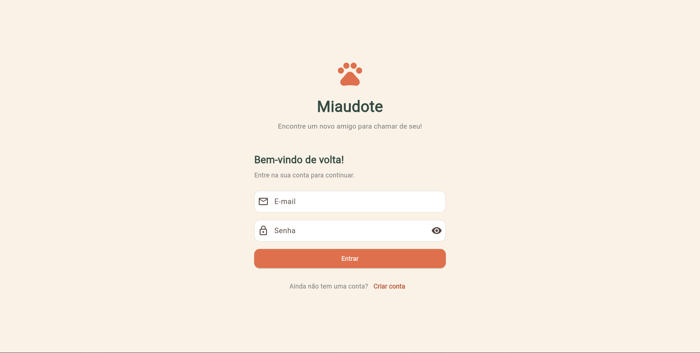
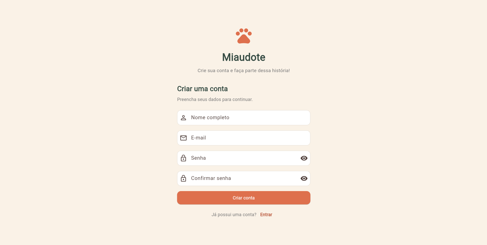
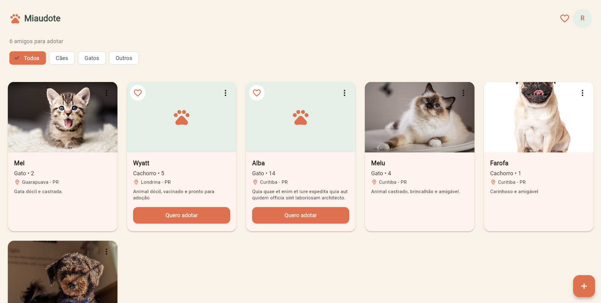
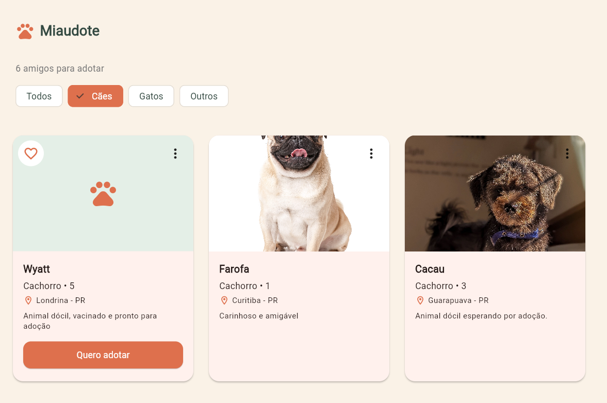
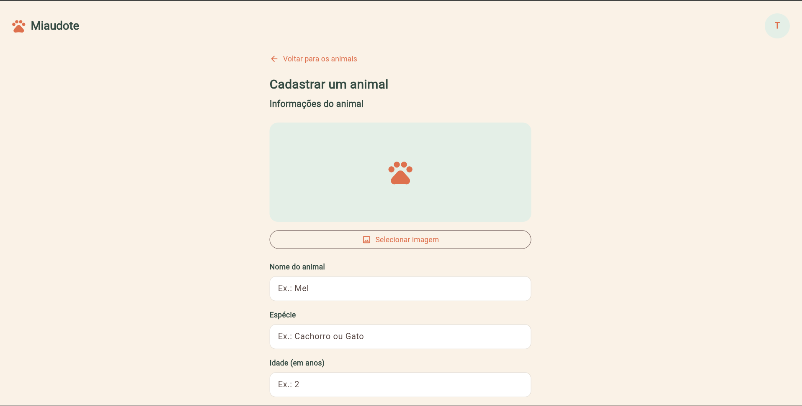
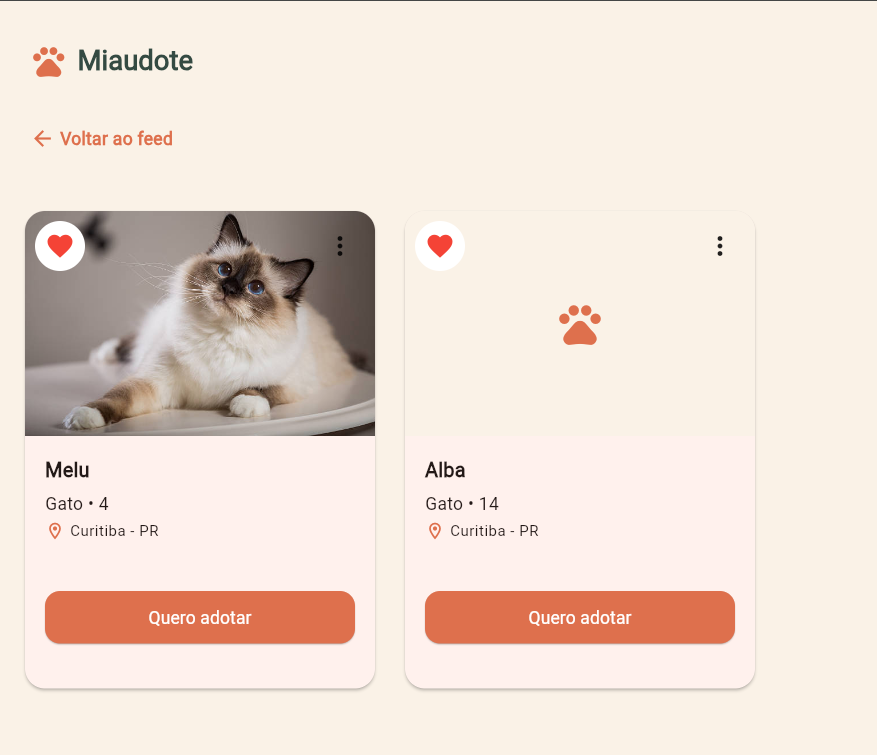
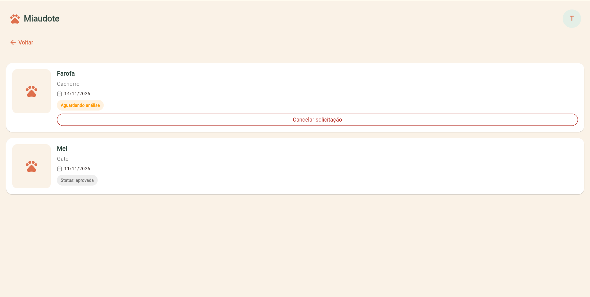

# MiAuDote 🐾

Aplicativo desenvolvido para facilitar a divulgação e a adoção responsável de animais, conectando pessoas interessadas em adotar com usuários que disponibilizam animais para adoção.

## Sobre o projeto

O MiAuDote é um projeto acadêmico desenvolvido com Flutter e Laravel. A aplicação utiliza uma API REST para comunicação entre o aplicativo e o banco de dados.

O objetivo é oferecer uma plataforma para divulgar animais disponíveis para adoção e permitir que interessados enviem solicitações de adoção.

## Tecnologias utilizadas

### Front-end
- Flutter
- Dart
- HTTP para consumo da API
- GoRouter para navegação

### Back-end
- PHP
- Laravel
- Laravel Sanctum para autenticação
- MySQL
- API REST

## Funcionalidades

- Cadastro de usuários.
- Login e autenticação.
- Listagem de animais disponíveis para adoção.
- Cadastro de animais.
- Edição e exclusão de animais.
- Envio de solicitações de adoção.
- Acompanhamento das solicitações de adoção.
- Gerenciamento de favoritos.

## Telas e rotas

| Tela | Rota | Descrição |
|---|---|---|
| Login | `/login` | Autenticação do usuário. |
| Cadastro | `/cadastro` | Cadastro de novos usuários. |
| Feed de animais | `/animais` | Listagem dos animais disponíveis para adoção. |
| Cadastro e edição de animais | `/animais/novo` | Cadastro de novos animais e edição dos dados de animais existentes. |
| Solicitação de adoção | `/solicitacoes-adocao/nova` | Envio de uma solicitação de adoção para um animal. |
| Favoritos | `/favoritos` | Listagem dos animais adicionados aos favoritos. |
| Minhas solicitações | `/minhas-solicitacoes` | Acompanhamento das solicitações de adoção enviadas e recebidas. |

## Estrutura do projeto

```text
Miaudote/
├── api/                 # API desenvolvida em Laravel
├── mobile/              # Aplicativo desenvolvido em Flutter
├── docs/
│   └── screenshots/     # Capturas de tela do aplicativo
└── README.md            # Documentação principal
```

## Como executar o projeto

### Back-end — Laravel (Opção A: API Laravel)

Entre na pasta da API:

```bash
cd api
```

Instale as dependências:

```bash
composer install
```

Configure o arquivo `.env` utilizando o `.env.example` como referência.

Gere a chave da aplicação:

```bash
php artisan key:generate
```

Configure a conexão com o banco de dados MySQL no arquivo `.env`. Antes de executar as migrations, certifique-se de que o banco de dados foi criado.

Execute as migrations e seeders:

```bash
php artisan migrate --seed
```

Crie o link simbólico do armazenamento:

```bash
php artisan storage:link
```

Inicie o servidor:

```bash
php artisan serve
```

A API ficará disponível em:

`http://127.0.0.1:8000/api`

### Front-end — Flutter

Em outro terminal, entre na pasta do aplicativo:

```bash
cd mobile
```

Instale as dependências:

```bash
flutter pub get
```

Execute o aplicativo:

```bash
flutter run -d chrome
```

**Observação:** o back-end deve estar em execução para que o aplicativo consiga consumir a API.


## Demonstração do aplicativo

### Tela de login


### Tela de cadastro


### Feed de animais


### Feed de animais com filtro


### Cadastro de animal


### Favoritos


### Minhas solicitações


## Autora

Raiane Cordeiro da Cruz

Projeto acadêmico — Análise e Desenvolvimento de Sistemas.